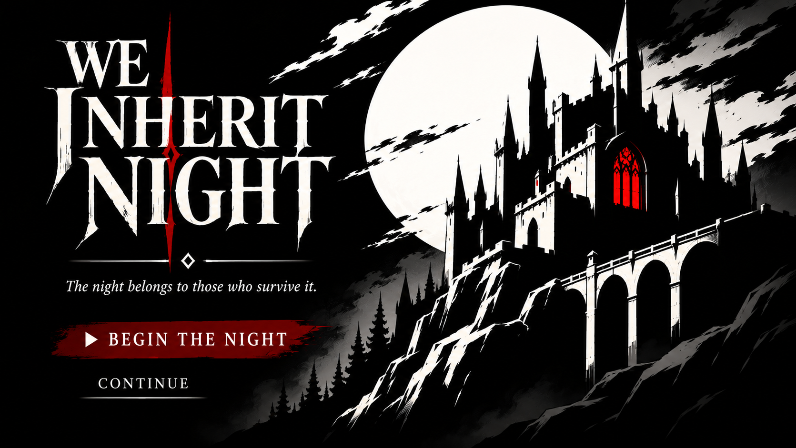

# We Inherit Night

**Power is inherited. Authority is not.**

A seven-night gothic political strategy game about inheritance, bargaining, and the power to revoke permission. **NEAR Testnet contracts enforce property rights, delegated authority, leases, and bounded payments**; story, Blood, and NPC decisions run off-chain. The illustrated browser game is playable without connecting a wallet.

**[Play the public Testnet game](https://we-inherit-night.onrender.com/)** · **[NEAR Testnet contract](https://testnet.nearblocks.io/address/night.we-inherit-night.testnet)** · **[Source repository](https://github.com/gl1tchpvnk/we-inherit-night)**



| | |
| --- | --- |
| Event | NEAR HACKATHON 2026 |
| Primary track | **Games With Real Economies** (`games`) |
| Platform | Single-player browser game; desktop and mobile |
| Network | **NEAR Testnet** (not mainnet) |
| Contract | `night.we-inherit-night.testnet` |
| Play requirements | Modern browser; no wallet, token purchase, or API key |
| Demo on X | **To be added before submission** |

## The game

You are a newly created vampire in **House Volari**. Your sire, Vesper, controls your access to the ancestral Crypt—and can take it away. You own the Library independently, but owning a room does not automatically shelter you from dawn. You have **three nights to secure shelter** and **seven nights to survive the court**.

Marius offers protection with obligations. Seraphine can grant sanctuary under an independent bargain. Other vampires investigate, negotiate, delegate permissions, make payments, and withdraw rights as their interests change. Decisions about whom to trust, what to sign, and what authority to surrender shape the final political reckoning.

Each night, explore and question the court, inspect your rights, then choose **one major commitment**—a political action, an agreement, feeding, or waiting for dawn. NPCs act in their own bounded phase; consequences are resolved, Blood is consumed at dawn, and the court changes. Navigation, inspection, and ordinary dialogue do not consume the major action.

The central design question: **what power do you really possess if somebody else can revoke the permission you depend on?**

## Judge walkthrough — do this, see that

**Fastest path:** [open the hosted game](https://we-inherit-night.onrender.com/). Starting a new game provisions a separate, operator-sponsored Testnet campaign. Initialization can take time. The recorded funded capacity was **five active campaigns**; admission may be unavailable when slots or reserves are exhausted. See [Operating limits](#operating-limits).

| Do this | Expected result |
| --- | --- |
| Select **Begin the Night** and continue or skip the prologue. | A new campaign opens with Vesper's demand; Testnet initialization finishes before consequential gameplay. |
| During exploration, open **Court records → Rights**. | Crypt authority is derived from Vesper; Library ownership is independent. The rights view identifies source, scope, expiry, and current effective status. |
| **Night I:** choose **Put my claim before Seraphine** and confirm. | A claim is filed, one Blood and the night's action are spent, and the campaign proceeds. A claim alone is not shelter. |
| **Night II:** select **I want a refuge of my own**; read the terms and accept **We have a deal · pay 0.02 NEAR**. | A prepaid **Testnet** campaign treasury pays for a contract-backed sanctuary lease. There is no player-wallet popup. |
| **Night III:** choose **Feed · restore 4 Blood** (or the available Feed action) and confirm. | Feeding advances the campaign. At the third reckoning Vesper withdraws Crypt access. The separate sanctuary agreement allows survival. |
| Reopen **Rights**; try the Crypt and enter the Library. | Crypt access is denied by the effective contract-backed authority state, while independently held Library ownership and sanctuary remain valid. |
| Reload and choose **Continue**. | Persisted decisions and verified rights resume; the completed events are not replayed as fresh actions. |

**Important proof distinction:** the locked Crypt UI reflects verified authority state; it does **not** send a deliberately failing Testnet transaction on every click. Contract unit and actual local NEAR Sandbox integration tests separately exercise unauthorized/revoked on-chain calls and verify rejection. The successful lease/payment and revocation have public Testnet transaction evidence in the linked reports.

Continue through seven nights to see the final political demand and ending. **Save and return to title** preserves a campaign. **Main menu → Quit Campaign → Confirm Quit Campaign** instead ends it and triggers settlement, archive, and reclamation; if interrupted, **Check settlement** resumes that process.

## What NEAR enforces

The game does not merely save a dialogue choice saying someone has permission. The smart contract controls the rights and economics that make the choice effective:

| Mechanic | On-chain enforcement | Gameplay impact |
| --- | --- | --- |
| Ownership | Isolated campaign property titles | A player's Library is not erased by their sire's unrelated revocation. |
| Delegation | Scope, parent grant, authorization, expiry, and revocation | An investigator or assistant may depend on a permission chain, which can be withdrawn at its root. |
| Sanctuary | Verified agreement, prepaid treasury debit, escrow, and lease | A political bargain establishes an actual independent right to shelter. |
| Betrayal | Authenticated revocation and effective-right checks | A previously permitted action can become unavailable. |
| NPC economy | Bounded Cassian–Lucien passage agreement, payment, and seller settlement | An NPC-to-NPC purchase can change political leverage. |
| Lifecycle | Bounded campaign provisioning, settlement, archival, and storage reclamation | Disposable play sessions do not retain unrestricted active on-chain state forever. |

**Genealogy is not authority.** Being a sire or a member of a House does not automatically confer ownership or spending rights. Descendant grants depend on the validity of their ancestors; independently rooted grants survive unrelated revocations.

The contract in [`contract/src/lib.rs`](contract/src/lib.rs) is authoritative for ownership, access, leases, and contract accounting. The game only presents consequential changes after the runtime verifies the relevant chain outcome. **Blood, narrative, dialogue, and turns are off-chain**; they are not advertised as contract-enforced.

## NPC behaviour and the bounded economy

The court includes **Vesper, Seraphine, Marius, Lucien, Mirelle, Dorian, Cassian, and Sabine**. They make bounded decisions using **deterministic, state-aware policies**, with structured observations, validated actions, persistence, and turn limits. Their actions can affect the player's options independently of the player's immediate choices.

**The submitted political gameplay does not call a live LLM.** The repository retains a separately tested model adapter, but current conversations are authored and reactive rather than freshly generated by an LLM. Do not interpret the word *autonomous* as claiming unrestricted model-driven planning, autonomous custody, or an open-ended market.

One implemented NPC purchase allows Cassian to spend a **prepaid 0.01 Testnet NEAR allowance** on a bounded three-night passage offered by Lucien, with contract settlement. The player can also pay **0.02 Testnet NEAR** from a sponsored treasury for sanctuary. These are *real Testnet contract transactions*, but Testnet tokens have no represented real-world commercial value. The economy is deliberately **small and mostly fixed-price**: there is no evolving player market, general NPC marketplace, recurring player income, or unrestricted agent spending. The contribution to the Games With Real Economies track is **enforceable economic rights and politically meaningful exchanges**, not simulation of a complex market. See [`docs/PASS3D.md`](docs/PASS3D.md).

## Architecture and trust boundaries

| Layer | Function | Code |
| --- | --- | --- |
| React + TypeScript | Cinematic scenes, exploration, interactions, rights display | [`src/`](src/) |
| Deterministic engine | Night progression, Blood, politics, NPC policies, endings | [`src/game.ts`](src/game.ts), [`src/agents.ts`](src/agents.ts) |
| Node + SQLite | Walletless sessions, durable campaign journals, serialized commands, recovery | [`scripts/testnet/`](scripts/testnet/) |
| Rust + `near-sdk` | Per-campaign ownership, grants, revocation, lease and treasury rules | [`contract/`](contract/) |
| NEAR Testnet | Transaction execution and inspectable authority/economic state | [`night.we-inherit-night.testnet`](https://testnet.nearblocks.io/address/night.we-inherit-night.testnet) |

The public service runs the frontend and gameplay API together, with persistent SQLite storage. Its operator sponsors finite Testnet resources. **Walletless play is custodial**, not a noncustodial or fully decentralized experience: the server manages restricted actor signing credentials and authenticates sessions. Method-, receiver-, and gas-limited function-call keys do **not** establish a game's spending policy; contract-enforced mandates and treasury limits do. The operator's hosting, clock/keeper, account custody, RPC access, and upgrade authority remain trust assumptions.

No private runtime keys are committed to the repository. Public `VITE_` settings are not suitable for secrets. See [`docs/RUNTIME_KEYS.md`](docs/RUNTIME_KEYS.md), [`docs/PASS4E.md`](docs/PASS4E.md), and [`render.yaml`](render.yaml).

## Implementation status and verification

| Capability | Status | Evidence or boundary |
| --- | --- | --- |
| Seven-night playable campaign, decisions, Blood, distinct conclusions | **IMPLEMENTED** | [`docs/GAMEPLAY_REFINEMENT.md`](docs/GAMEPLAY_REFINEMENT.md), browser/Sandbox tests |
| Contract ownership, delegation, revocation, expiry, leases, settlement | **IMPLEMENTED** | [`contract/src/lib.rs`](contract/src/lib.rs), [`tests/sandbox/`](tests/sandbox/) |
| Public walletless Testnet campaign and paid sanctuary | **IMPLEMENTED; reported public acceptance PASS** | [`docs/PUBLIC_DEPLOYMENT.md`](docs/PUBLIC_DEPLOYMENT.md) and public transaction evidence |
| NPC policies, independent nightly actions, one Cassian–Lucien purchase | **IMPLEMENTED** | [`docs/PASS3D.md`](docs/PASS3D.md), [`tests/sandbox/pass3d.test.mjs`](tests/sandbox/pass3d.test.mjs) |
| Save/reload, confirmed Quit, settlement, archive, reclamation and replay | **IMPLEMENTED; reported public acceptance PASS** | [`docs/PUBLIC_DEPLOYMENT.md`](docs/PUBLIC_DEPLOYMENT.md), [`evidence/quit-campaign/`](evidence/quit-campaign/) |
| Illustrated graphic-novel interface, keyboard and reduced-motion support | **IMPLEMENTED; some art provisional** | [`VISUAL_CANON.md`](VISUAL_CANON.md) |
| Live generative-AI decisions | **PARTIAL / DISABLED** | Model adapter retained; deterministic NPC gameplay active |
| General NPC markets, multiplayer, open-ended agent purchasing, council-vote system | **NOT IMPLEMENTED** | Outside submission scope |

**Reported release evidence (November 13; not independently rerun for this README):** the project release audit recorded a complete *public* walletless seven-night Testnet campaign ending in **The Unbound**, including **56 unique NPC turns**, paid sanctuary retained, reload, a personal finale, settlement, replay, Quit, and reclamation. The auditor reported **21 original-campaign transactions** independently checked as FINAL-success. This is the scope of that recorded audit, **not** a claim that every path or concurrent-user load has been exhaustively verified. Refer to the repository's current release evidence for the underlying records.

Public proof points from an earlier, separately documented hosted Quit run (do not confuse these with the latest campaign's full set of receipts):

| Event | Testnet transaction |
| --- | --- |
| Accepted sanctuary lease | [`3eEDSmkA7hdVAR7PAfb4ugCxFHQQCLJQwtZkXBex2CLR`](https://testnet.nearblocks.io/txns/3eEDSmkA7hdVAR7PAfb4ugCxFHQQCLJQwtZkXBex2CLR) |
| Reclaim closed campaign | [`8GLziUSt7TtbQZRrkNrKJSicvySwBBtyVVxepH1dAvhF`](https://testnet.nearblocks.io/txns/8GLziUSt7TtbQZRrkNrKJSicvySwBBtyVVxepH1dAvhF) |
| Create following campaign | [`3FgkhAMJFUQxfqZ7gwFc35T3ZNF7WQHTeHxQ9EGMGhqG`](https://testnet.nearblocks.io/txns/3FgkhAMJFUQxfqZ7gwFc35T3ZNF7WQHTeHxQ9EGMGhqG) |

Historical reports describe the version and environment they tested; a local Sandbox PASS does not by itself prove a public Testnet release. Links, transactions, and specific in-game copy should be rechecked against the final deployment before submission.

## Run locally (real NEAR Sandbox)

**Prerequisites:** Linux x86_64 or Ubuntu WSL2; Git; Node.js **24.13.0**, npm **11.6.2**, Rust **1.99.0**, `cargo-near` **0.22.0**, C/C++ build tools, `curl`, and `tar`. These are recorded tested versions, not a compatibility guarantee for other environments. The pinned Sandbox installer targets Linux x86_64.

```bash
git clone https://github.com/gl1tchpvnk/we-inherit-night.git
cd we-inherit-night
npm ci --include=dev --ignore-scripts
cp .env.example .env
rustup target add wasm32-unknown-unknown
cargo install cargo-near --version 0.22.0 --locked  # skip if already installed
npm run contract:wasm
bash scripts/setup-sandbox.sh
npm run dev
```

Open **http://127.0.0.1:5187/**, choose **Begin the Night**, and follow the walkthrough. Local gameplay uses the **actual compiled contract on local NEAR Sandbox**, not merely a UI mock. No wallet or API key is needed. Disposable credentials and saves are under ignored `.local/` paths; the development bridge is for loopback use. Failed Sandbox initialization must not be mistaken for successful on-chain play.

### Tests and production build

After setup, from the repository root:

```bash
cargo test --lib --locked
cargo build --features local-demo --bin local-demo --locked
npm test
npm run build
npm run test:sandbox
```

The native demo build is a prerequisite for the Node bridge test on a clean checkout. `npm run test:sandbox` exercises actual local-chain calls, including access denials; it is not public Testnet verification. Backend tests need loopback socket access. A narrower economic suite is available as `npm run test:economy`.

## Configuration and public hosting

The checked-in [`.env.example`](.env.example) defaults to Sandbox. Relevant settings include:

| Variable | Purpose |
| --- | --- |
| `VITE_MODE=sandbox` | Local Sandbox gameplay |
| `VITE_MODE=testnet`, `VITE_TESTNET_BACKEND=1` | Testnet frontend backed by the walletless server |
| `VITE_NETWORK`, `VITE_RPC_URL`, `VITE_CONTRACT_ID` | Public chain selection and contract identifiers |
| `VITE_CAMPAIGN_ID` | Optional direct Testnet world view |
| `NIGHT_CONFIG_JSON` | Server-side public account/config mapping (no secrets) |
| `NIGHT_RUNTIME_KEYS` | **Protected server-only** restricted signing credentials |
| `NIGHT_DATA_DIR` | Persistent SQLite/journal directory |
| `NIGHT_LLM_ENABLED=0` | Disable the retained LLM adapter for current gameplay |

Render configuration is in [`render.yaml`](render.yaml). The public game uses **one Node service with persistent disk**, not a static-only `dist/` deployment. Runtime provisioning and admission are limited; see [Operating limits](#operating-limits).

## Operating limits

The public backend is an **operator-run, custodial** service. It holds restricted actor credentials and performs scheduled settlement; visitors do not hold campaign keys. The recorded funded capacity was **five active campaigns**, not a five-concurrent-player load-test result. The actual number admitted at a given moment depends on free capacity, Testnet balances, and server health. No guarantee of concurrent availability or indefinite free hosting is implied. The campaign lifecycle can reclaim active world state after confirmed closure, but Testnet gas and retained records still consume resources. See [`docs/CAMPAIGN_CAPACITY.md`](docs/CAMPAIGN_CAPACITY.md), [`docs/PASS4C2.md`](docs/PASS4C2.md), and [`docs/PUBLIC_DEPLOYMENT.md`](docs/PUBLIC_DEPLOYMENT.md).

## Provenance, limitations, and license

Project development was reported to begin in November 2026, within the **NEAR HACKATHON 2026** eligibility window. The Git commit history alone does not date all pre-Git work. Development was AI-assisted with **OpenAI Codex** using creator-authored project requirements, narrative direction, and art. Git was initialized after substantial development; [`docs/GIT_BASELINE.md`](docs/GIT_BASELINE.md) explains the initial version-control snapshot. This was not a pre-existing released game ported from another chain.

Dependencies include React, React DOM, TypeScript, Vite, Rust `near-sdk`, and `near-workspaces`; exact versions and upstream dependencies are in [`package.json`](package.json), [`package-lock.json`](package-lock.json), [`Cargo.toml`](Cargo.toml), and [`Cargo.lock`](Cargo.lock). Cover, castle, and vampire portraits are creator-supplied; some room art is provisional/generative as documented in [`VISUAL_CANON.md`](VISUAL_CANON.md).

Limitations are material to judging: the hosted game is operator-custodial; the NPC policy is deterministic, not live LLM inference; the economy is bounded, not an evolving market; public capacity is finite; and the off-chain engine is trusted for story and turn state. The game is a working vertical slice, not a fully decentralized persistent world.

Released under the [MIT License](LICENSE).

<!-- Before submitting: replace the X placeholder with the real public post URL. Confirm latest public assets match the submitted main branch, and do not add claims unsupported by current evidence. -->
